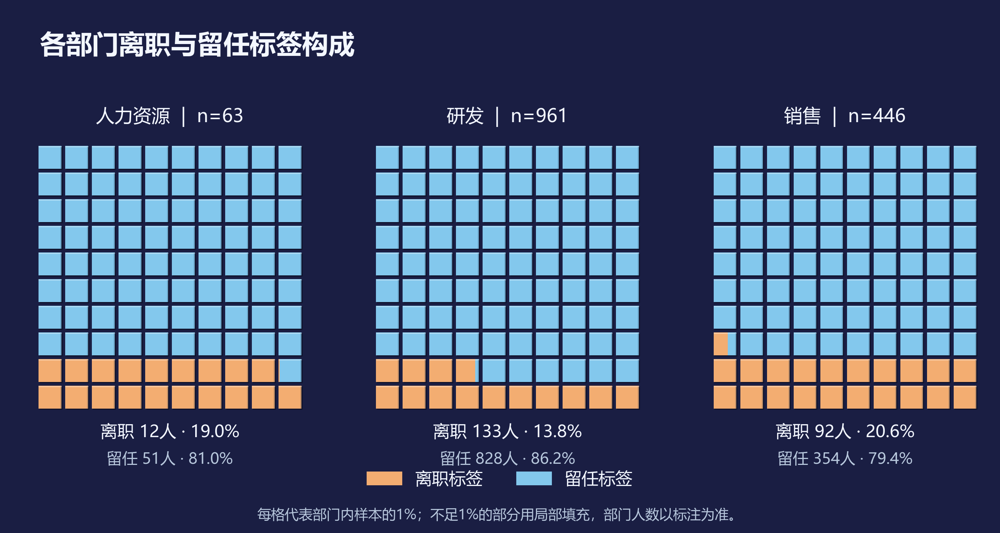
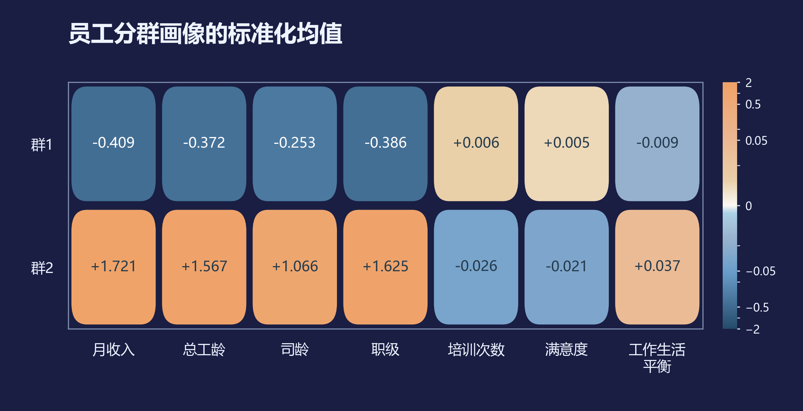
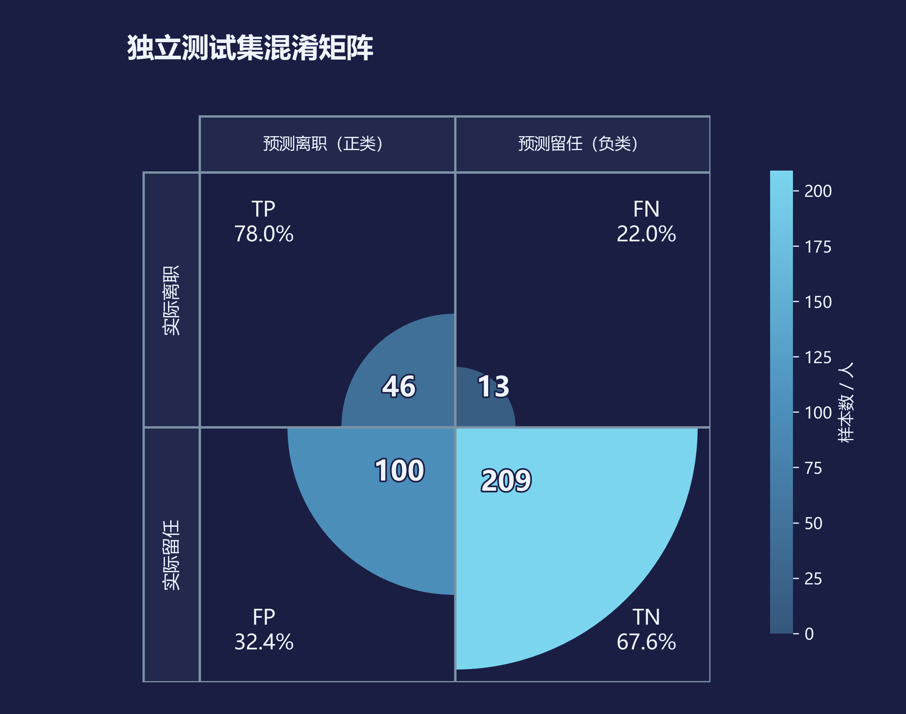
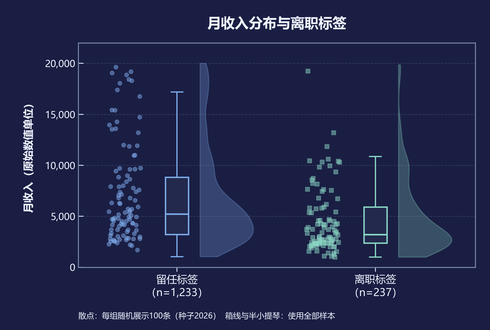

# 商业数据分析｜员工结构与离职分析

以模拟企业 HR 管理场景为背景，围绕 **岗位离职案例集中度、员工结构差异和离职标签识别**，完成数据清洗、商业分析、模型评估与交互式可视化，并提出岗位访谈、工作负荷核查及员工支持建议。

**1,470 条样本 · 35 个原始字段 · 3 个分析模块 · 24 张图表 · 1 个交互大屏**

数据选自课程附件A对应的 **IBM HR Analytics Employee Attrition & Performance**。该数据集由 IBM 数据科学家制作，为虚构样本；本项目将其用于模拟企业分析，不代表 IBM 的真实员工情况。

## 主要成果

- **[分析论文](docs/商业数据分析期末论文.docx)**：完整呈现研究背景、分析方法、结果解释与管理建议。
- **[Jupyter Notebook](商业数据分析.ipynb)**：按步骤运行数据处理、模型分析与可视化。
- **[可视化图表](outputs/figures)**：24 张 PNG 图表，涵盖结构比较、分群画像、模型评估与关联分析。
- **[分析结果表](outputs/tables)**：保存 ABC 分类、聚类、预测及评估明细，便于查看与复核。

## 部分成果展示

采用统一暗色背景，通过不同图形展示构成、群体差异和模型表现。点击图片可查看大图。

| 部门标签构成 · 华夫图 | 员工分群画像 · 圆角热力图 |
| :---: | :---: |
| [](outputs/figures/fig05_层叠柱形图.png) | [](outputs/figures/fig15_分群画像.png) |
| 每格表示部门内样本的 1%，局部填充保留精确比例。 | 对照两个群体在收入、工龄、职级等维度的特征。 |

| 分类模型表现 · 扇形混淆矩阵 | 收入与离职标签 · 雨云图 |
| :---: | :---: |
| [](outputs/figures/fig19_混淆矩阵.png) | [](outputs/figures/fig23_收入箱线分布.png) |
| 同时呈现识别、漏报和误报；比例按实际类别计算。 | 结合散点、箱线和密度，展示两组收入分布。 |

### 交互式大屏

**[员工结构与离职管理大屏](outputs/dashboard/员工离职管理.html)** 支持按部门、加班标签、员工群体与司龄筛选，指标、图表和岗位汇总明细同步更新。

下载 HTML 后在浏览器中打开即可交互，无需联网或启动 Python 服务。GitHub 文件页面展示的是源码，需要下载后打开才能操作。

## 分析方法与主要发现

| 分析模块 | 方法 | 主要发现 |
| --- | --- | --- |
| 岗位案例集中度 | 按离职人数进行 ABC 分类 | 四个 A 类岗位覆盖 199 个离职案例，占全部离职案例的 **83.97%**。 |
| 员工结构分群 | 7 个特征标准化，比较 K=2～6 的轮廓系数 | 最终选取两个群体，样本数分别为 **1,188** 和 **282**；离职标签占比分别为 **18.01%** 和 **8.16%**。 |
| 离职标签识别 | 比较逻辑回归、随机森林与常数基线 | 选定逻辑回归，独立测试集 ROC-AUC 约 **0.826**、AP 约 **0.609**；识别 46 人、漏报 13 人、误报 100 人。 |

分类模型采用分层 75%/25% 训练测试划分，在训练集内部进行五折交叉验证；阈值依据训练集折外 F2 选择，为 0.09。聚类不使用离职标签，也不将聚类标签作为预测输入。

结果用于确定后续调查与员工支持的优先方向。数据没有明确观察期，离职标签占比不能解释为年度离职率；横截面关联不能证明因果关系。月收入币种未明确，图表使用原始数值单位。

## 快速开始

下载仓库后，在项目根目录打开终端。已有所需依赖可直接运行；新环境先安装依赖：

```bash
python -m pip install -r requirements.txt
```

重新计算分析结果、绘制全部图表并生成大屏：

```bash
python run_all.py
```

只重绘图表：

```bash
python scripts/visuals.py
```

也可以在 Jupyter 中打开 `商业数据分析.ipynb`，按顺序运行单元格。Notebook 与命令行共用最终绘图代码，能够从数据重新生成当前图形样式。中文字体优先使用 Microsoft YaHei，其次为 SimHei；更换字体或依赖版本可能影响文字布局与抗锯齿效果。

## 项目结构

```text
data/             原始数据、来源说明与清洗结果
docs/             分析论文、字段口径与答辩说明
outputs/
  figures/        24 张静态图表
  tables/         分析与模型评估结果
  dashboard/      交互式 HTML 大屏
scripts/
  figure_styles/  最终图形样式
  pipeline.py     数据处理与分析建模
  visuals.py      统一绘图入口
  dashboard.py    大屏生成
商业数据分析.ipynb  分步分析 Notebook
run_all.py        一键运行入口
requirements.txt  Python 依赖
```

## 数据来源与许可

- **来源**：[Kaggle · IBM HR Analytics Employee Attrition & Performance](https://www.kaggle.com/datasets/pavansubhasht/ibm-hr-analytics-attrition-dataset)，发布者 pavansubhash，版本 1。
- **获取方式**：2026 年 10 月 27 日通过 Kaggle 官方下载接口获取，未使用网页爬虫。
- **来源记录**：[原始文件清单](data/raw/manifest.json)、[平台元数据](data/raw/platform_metadata.json)和[数据集说明](data/raw/dataset_description.json)。
- **许可**：平台标注为 “Database: Open Database, Contents: Database Contents”，详见 [数据许可说明](DATA_LICENSE.md)。原始数据与衍生数据保留来源及适用许可。

分析使用固定随机种子 2026。修改数据、特征或模型参数后，应重新运行分析并更新相应解释。AI 辅助使用情况见论文中的披露。
